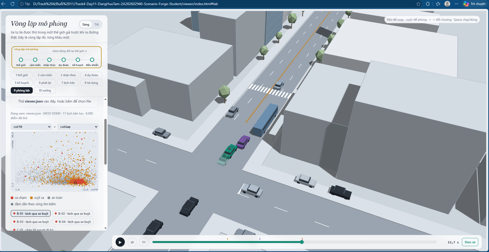
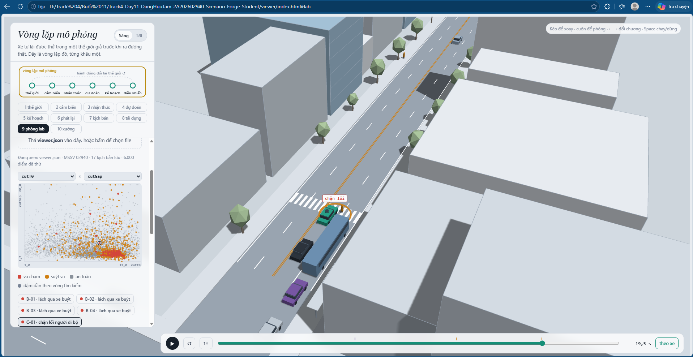
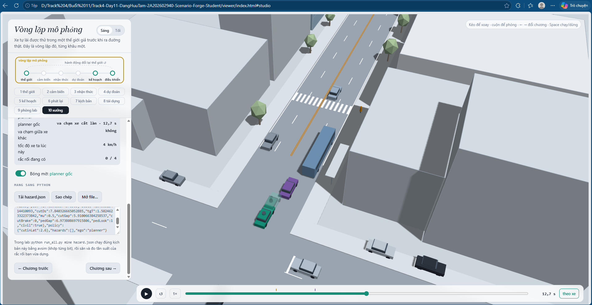
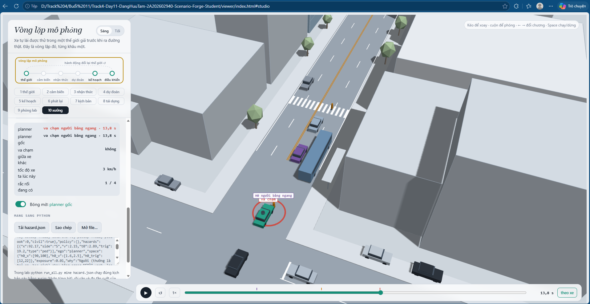

MSSV: 02940

# Lab 11 · Scenario Forge — báo cáo

Mỗi câu: trả lời ngắn, **trích số từ `evidence/`** (ghi tên file và trường, ví dụ `mc.json: crashes = 4`). Grader chạy lại với MSSV của bạn; số không khớp `evidence/` thì mất điểm phần D (RUBRIC), và câu dựa trên số sai khó được điểm đầy đủ. Không cần văn hay: một bảng nhỏ và hai, ba câu giải thích là đủ.

Thị trấn của bạn (`meta.json: _run.town`): **D**

> Ghi chú: `run_all.py` chỉ đọc MSSV 6–12 chữ số từ dòng đầu file này, nên `evidence/` được tạo bằng `LAB11_MSSV=02940 python run_all.py all` (đúng cách grader truyền MSSV). Mọi file mang `_run.mssv = "02940"`, `_run.town = "D"`, `quick = false`.

## 1. Phát lại log có trung thực không? (bước A)

| `replay.json` | giá trị |
|---|---|
| `n` | 400 |
| `dropped_human_crash_logs` (log người lái tự va chạm, bị bỏ) | **3** |
| `n_used` | 397 |
| `replay.crashes` (planner trên log phát lại) | **100**: `rear` 99, `side` 1 |
| `reactive.crashes` (planner trong thế giới phản ứng) | **0** |
| `crash_in_both` | 0 |

99/100 va chạm của "phát lại" là `rear`, và cả 100 vụ biến mất trong thế giới phản ứng (`crash_in_both = 0`). Đó là va chạm **giả**. Khi phát lại, xe phía sau (xe bám đuôi TG) chạy đúng quỹ đạo đã ghi lúc người lái thật đi trước nó. Planner thận trọng hơn người lái: nó phanh **sớm hơn và mạnh hơn** (trước xe cắt làn, trước vạch bị xe buýt che). Nhưng log không biết planner đã phanh, nên TG không phanh theo, cứ lao lên với tốc độ đã ghi và tông đuôi xe ta. Trong thế giới phản ứng, TG lái kiểu IDM thấy xe ta giảm tốc và giảm theo. Vụ `side` duy nhất cùng bản chất: một xe khác đi theo đường đã ghi, không nhường planner.

Ví dụ `replay_only[0]`: kịch bản 6, `contact = "rear"`, `min_ttc_reactive = 2.73 s`. Đường ướt (`mu = 0.5`), TG bám rất sát (`tgT = 0.65 s`), C2 cắt vào sớm (`cutT0 = 2.6 s`, `cutDs = −9.6 m`). Planner phanh sớm để giữ khoảng cách với C2 và giảm tốc trước vạch bị che. TG trong log vẫn chạy với tốc độ của lúc người lái thật chưa phanh, với khoảng cách 0,65 s trên đường ướt, nên tông đuôi. Trong thế giới phản ứng, TG phanh theo và TTC nhỏ nhất chỉ xuống 2,73 s, không va chạm.

## 2. Kịch bản bất khả thi (bước B)

Luật trong `feasible.is_feasible` (g = 9,81 m/s², μ = `mu` của mặt đường):

| Luật | Căn cứ vật lý |
|---|---|
| Chuyển làn hình cos 3,5 m trong `cutDur` s có gia tốc ngang đỉnh a = (π/cutDur)²·3,5/2; loại nếu a > μg | Lực ngang chỉ đến từ ma sát lốp–đường, nên gia tốc ngang ≤ μg (đường ướt μ = 0,5 thì chỉ còn 4,9 m/s²) |
| `cutBrake` > μg thì loại | Phanh dọc cũng bị giới hạn bởi ma sát: không xe nào giảm tốc mạnh hơn μg |
| `pedV` > 2,5 m/s thì loại | Người qua đường đi khoảng 1,2–1,5 m/s, đi rất nhanh khoảng 2,5 m/s; hơn nữa là chạy nước rút, không phải người đi bộ của mô hình này |
| `cutV` ∉ (0, 22] m/s thì loại | Xe đứng yên không "cắt làn"; 22 m/s ≈ 80 km/h là trần hợp lý trên con phố đô thị này |

`hunt.json: <hunt>.infeasible`: **`cut_in` 7**, `crosswalk_block` 4, `rear_ended` 2, `bus_bypass` 1. Cuộc săn `cut_in` bị kéo về phía bất khả thi nhiều nhất. Điểm nguy hiểm của nó là −TTC tới C2, và điểm này tốt nhất khi C2 nhập làn **gắt nhất** (`cutDur` ngắn) rồi **phanh mạnh nhất** (`cutBrake` lớn) trên đường **trơn** (μ nhỏ). Đó đúng là vùng vượt μg. CEM chỉ biết "nguy hiểm hơn là tốt hơn", nên elite cứ dồn về mép giới hạn vật lý. Nếu **đếm** các kịch bản đó là va chạm, ước lượng bị thổi phồng: IS cộng vào P(kiểu) những va chạm mà không xe thật nào tạo ra được. Còn CEM sẽ co hẳn về vùng bất khả thi (ở đó "dễ thắng" nhất), và ta "sửa" planner cho những tình huống không tồn tại.

## 3. Monte Carlo cho bạn biết gì (bước C1)

`mc.json`: k = `crashes` = **2**, n = **3000**, p̂ = `p` = **6,67·10⁻⁴**, Wilson 95 % = [`lo` **1,83·10⁻⁴**, `hi` **2,43·10⁻³**]. Hai vụ là 1 `bus_bypass` + 1 `crosswalk_block` (`mc.json: modes`). `infeasible` = 8 kịch bản bị loại, không chạy.

Để khoảng tin cậy còn ±20 % của p: 1,96·√(p(1−p)/n) = 0,2·p, suy ra n ≈ 1,96²/(0,2²·p) ≈ **96/p** = 96/6,67·10⁻⁴ ≈ **144 000 lần chạy**, gấp 48 lần ngân sách 3 000.

Kiểu **chưa hề xuất hiện** trong 3 000 lần: `cut_in`, `rear_ended` và `other` (k = 0). Không được báo 0. Con số đúng là cận trên Wilson 95 %, `mc.json: per_mode.<kiểu>.hi` = **1,28·10⁻³** (gần quy tắc 3/n = 10⁻³), tức "P < 1,28·10⁻³ ở mức 95 %". Với `bus_bypass` và `crosswalk_block` (k = 1 mỗi kiểu), `per_mode.hi` = 1,89·10⁻³.

## 4. Importance sampling, ESS và độ suy biến (bước C3)

`estimate.json: seeds[i].per.<kiểu>` (n = 600 mẫu mỗi kiểu mỗi seed):

| Kiểu | Seed | `p` | `hits` | `ess` | `top_share` |
|---|---|---|---|---|---|
| bus_bypass | 0 | 1,75·10⁻⁴ | 22 | 135,7 | 0,44 |
| bus_bypass | 1 | 3,76·10⁻⁴ | 31 | 120,8 | 0,18 |
| bus_bypass | 2 | 8,41·10⁻⁴ | 38 | 99,8 | 0,26 |
| cut_in | 0 / 1 / 2 | 0 (báo cận `upper_zero_hits` = 0,025) | 0 / 0 / 0 | 114,2 / 119,2 / 104,2 | 0 |
| crosswalk_block | 0 | 1,97·10⁻⁷ | 52 | 112,0 | 0,28 |
| crosswalk_block | 1 | 1,19·10⁻⁶ | 41 | 121,9 | 0,27 |
| crosswalk_block | 2 | 2,07·10⁻⁷ | 41 | 121,2 | 0,12 |
| rear_ended | 0 / 1 / 2 | 0 (báo cận `upper_zero_hits` = 0,025) | 0 / 0 / 0 | 133,0 / 107,1 / 129,9 | 0 |
| **total** | 0 / 1 / 2 | 1,75·10⁻⁴ / 3,77·10⁻⁴ / 8,41·10⁻⁴ | | | |

**Ba seed có đồng ý không?** Chỉ cùng bậc độ lớn: `bus_bypass` chênh **4,8 lần** (1,75 đến 8,41·10⁻⁴), `crosswalk_block` chênh **6 lần** (1,97·10⁻⁷ đến 1,19·10⁻⁶). Trung vị total = 3,77·10⁻⁴ nằm trong khoảng Wilson của MC [1,83·10⁻⁴; 2,43·10⁻³] nhưng thấp hơn p̂ MC = 6,67·10⁻⁴, đúng hướng README cảnh báo (IS ở ngân sách này thường thấp hơn sự thật 1,5–4 lần).

**Cái bẫy số 3, thấy rõ ở `crosswalk_block`:** MC đã bắt được **1 vụ** trong 3 000 lần, tức Wilson [5,9·10⁻⁵; 1,89·10⁻³]. Trong khi đó IS báo chỉ 2·10⁻⁷ đến 1,2·10⁻⁶, thấp hơn cận dưới của MC khoảng **50 lần trở lên**. Nghĩa là cuộc săn `crosswalk_block` đã tìm ra **một** cách chặn vạch (theo điểm "khoảng phanh còn lại", nó kéo q về chỗ dễ va chạm nhất), nhưng không phải cách **hay xảy ra nhất** ngoài phân phối tự nhiên. Đề xuất q bỏ sót vùng đó, nên IS không có mẫu nào ở đấy để mà nặng ký. Con số `crosswalk_block` của IS vì vậy là **chặn dưới đáng ngờ**, không phải ước lượng tin được.

**`top_share`:** trong `estimate.json` không ô nào vượt 0,5 (lớn nhất 0,44 ở `bus_bypass` seed 0), nhưng `top_share` thấp **không** chứng minh ước lượng đúng, như `crosswalk_block` ở trên cho thấy. Khi `top_share` lớn, ví dụ `fix.json: chosen_test.bus_bypass` có `hits = 1`, `top_share = 1,0`, hay `table[0]` (`cautionV 5.0`) có `top_share = 1,0` ở cả hai kiểu, thì p = mean(w·y) **chỉ là trọng số của đúng một mẫu chia cho n**. Thêm hay bớt mẫu đó, p nhảy từ 0 lên cả bậc độ lớn, và khoảng ±1,96·se cũng vô nghĩa. ESS khoảng 100–136 / 600 cho thấy trọng số lệch, nhưng **không** thay cho số lần thử độc lập.

**Ngân sách:** `estimate.json: budget` = **16 800** lần chạy cho cả 4 kiểu × 3 seed. `bus_bypass` seed 1 có se/p = 1,26·10⁻⁴/3,76·10⁻⁴ ≈ 0,34. MC muốn cùng sai số tương đối cần n ≈ 1/(p·0,34²) ≈ **23 700** lần, cho riêng một kiểu. `crosswalk_block` seed 0 (p = 1,97·10⁻⁷, se/p ≈ 0,34) cần n ≈ **45 triệu** lần, trong khi IS chỉ dùng khoảng 3 000 lần chạy (săn 8×300 + ước lượng 600) mỗi seed. Nhưng như trên, độ chính xác "danh nghĩa" của IS chỉ có giá trị khi q phủ đúng vùng va chạm.

**`other`:** `estimate.json: other` = {k 0, n 3000, p 0, hi 1,28·10⁻³, `source: "mc.json"`}. Va chạm không thuộc kiểu nào không có điểm nguy hiểm riêng, nên không có gì cho CEM tối ưu. Vì thế không săn mà lấy từ Monte Carlo tự nhiên (C1), rồi cộng vào total. Với k = 0, phần đó vẫn mang cận trên 1,28·10⁻³ chứ không phải 0.

## 5. Các kiểu thất bại (bước C2 + 3D)

`hunt.json: <hunt>.found`:

| Cuộc săn | `found` | `infeasible` |
|---|---|---|
| bus_bypass | **bus_bypass 119** | 1 |
| cut_in | **bus_bypass 29** (không có cut_in) | 7 |
| crosswalk_block | **crosswalk_block 13** | 4 |
| rear_ended | bus_bypass 2, crosswalk_block 2 (không có rear_ended) | 2 |

**bus_bypass (lách qua xe buýt).**  Xe buýt đỗ ở làn bên chắn C2. C2 chờ một khe theo *gap acceptance* rồi **lách sang làn xe ta**, bò chậm (< 6 m/s, x < 112 m) quanh đuôi xe buýt. Xe ta đang giảm về `cautionV` gần vạch bị che, nhưng chỉ coi C2 là xe phía trước khi C2 lệch ngang dưới `cutinLat` = 2,15 m. Đến lúc đó khoảng cách đã quá ngắn để phanh êm, và xe ta tông vào C2.

**crosswalk_block (chặn lối người đi bộ).**  Người đi bộ P1 bị xe buýt che. Họ chờ tới khi xe gần nhất mà họ *nhìn thấy* còn đủ xa, rồi bước lên vạch. Xe ta chỉ thấy P1 khi P1 bước ra khỏi đuôi xe buýt, phanh gấp và dừng được, nhưng **thân xe đã nằm trên vạch**, P1 phải đứng lại (`kind == "block"`).

**Không tìm thấy:** `cut_in` và `rear_ended`. Cuộc săn `cut_in` trôi hết về `bus_bypass` (29 vụ). Cuộc săn `rear_ended` chỉ được 2 `bus_bypass` + 2 `crosswalk_block`. Mức tin thấp: chỉ là "không thấy ở ngân sách này". Con số cần báo là cận `upper_zero_hits` = 0,025 (IS) và < 1,28·10⁻³ (MC), không phải 0. Câu 4 đã cho thấy cuộc săn có thể bỏ sót cả một vùng va chạm.

**Một cuộc săn chung:** chính `found` ở trên trả lời. Cuộc săn `cut_in` dù dùng điểm nguy hiểm riêng (TTC tới C2) vẫn bị hút trọn về `bus_bypass`, chỗ va chạm "dễ" nhất của planner này. Một cuộc săn chung sẽ co về `bus_bypass`, bỏ sót `crosswalk_block` (điểm nguy hiểm khác hẳn: khoảng phanh trước người đi bộ), và IS không có đề xuất phủ các kiểu khác, nên báo thấp sai. Vì vậy mỗi kiểu cần một cuộc săn riêng.

## 6. Sửa planner (bước E + 3D)

Policy được chọn (`fix.json: chosen.policy`): **`{"cutinLat": 2.6}`**, coi một xe lệch ngang đến 2,6 m (thay vì 2,15 m) đã là xe phía trước. Chọn trên TRAIN bằng `choose_policy` (cận trên nhỏ nhất, mất ≤ 5 % quãng đường).

| | `fail` | `fail_hi_seen` | `fail_hi` | `unseen` | `progress` (m) | `harsh` (khung/lượt) |
|---|---|---|---|---|---|---|
| Gốc, TRAIN (`baseline_train`) | 5,31·10⁻⁴ | 1,09·10⁻³ | 1,09·10⁻³ | — | 215,7 | 8,53 |
| Chọn, TRAIN (`chosen`) | 1,92·10⁻⁶ | 4,16·10⁻⁶ | 4,16·10⁻⁶ | bus_bypass | 215,8 | 7,52 |
| **Chọn, TEST** (`chosen_test`) | **3,24·10⁻⁶** | **9,55·10⁻⁶** | **1,29·10⁻³** | — | 217,4 | 7,73 |
| **Gốc, TEST** (`baseline_test`) | **4,89·10⁻⁴** | 9,74·10⁻⁴ | 2,25·10⁻³ | — | 217,4 | 7,91 |

TRAIN chỉ để sàng: ở đó `bus_bypass` của bản sửa là `unseen`, nên "0 va chạm" không chứng minh gì. Trên **TEST** (seed mới + cuộc săn mới nhắm thẳng vào bản sửa), cuộc săn tìm lại được `bus_bypass` nhưng chỉ **1 hit** (`chosen_test.bus_bypass.hits = 1`, `p = 3,21·10⁻⁶`, `top_share = 1,0`), so với 30 hit và `p = 4,89·10⁻⁴` của policy gốc. Thất bại giảm khoảng 150 lần theo số dữ liệu cho thấy. Quãng đường không đổi (217,4 m cả hai), khung phanh gấp giảm nhẹ (7,73 so với 7,91).

**Vì sao `fail_hi` của bản sửa (1,29·10⁻³) lớn hơn `fail` của gốc (4,89·10⁻⁴) dù bản sửa tốt hơn thật?** Vì `fail_hi` phải cộng **mọi** va chạm khác của xe ta, đếm trên tập tự nhiên riêng: `chosen_test.other_crashes` = {k 0, n 3000, hi **1,28·10⁻³**}. Không thấy vụ nào trong 3 000 lần thì cận trên vẫn khoảng 1,3·10⁻³, và cận đó áp như nhau cho mọi policy. `fail_hi_seen` (9,55·10⁻⁶) là cái dữ liệu cho thấy; `fail_hi` là cái **chứng nhận được** ở ngân sách này. Muốn chứng nhận dưới 10⁻³ cần hàng chục nghìn lần chạy.

 Ảnh có **bóng mờ** (policy gốc), chụp ở chương 10 với `evidence/shots/fix_ghost_B01.json` (kịch bản `bus_bypass` B-01 của `viewer.json`, planner `cutinLat 2.6`). Bóng mờ (policy gốc) lao vào C2 đang lách quanh đuôi xe buýt ở t ≈ 12,7 s. Xe ta với `cutinLat 2.6` nhận C2 làm xe phía trước sớm hơn, khi C2 còn lệch 2,6 m, nên bắt đầu giảm tốc sớm và không va chạm. Chạy bằng avsim cũng cho kết quả này với cả 4 kịch bản B-01 đến B-04: gốc va chạm C2 ở 12,5–12,7 s, bản sửa không va chạm.

**Núm "nghe thì an toàn hơn" nhưng làm tăng thất bại: `T` (khoảng cách thời gian giữ với xe trước).** Tăng `T` từ 1,6 lên **2,0 s** nghe như "giữ xa hơn, an toàn hơn". Nhưng TRAIN `fail` (`table[8]`) = **1,40·10⁻³**, cao gấp **2,6 lần** gốc (5,31·10⁻⁴), toàn bộ do `bus_bypass` (1,40·10⁻³, `top_share` 0,44). Lý do là thế giới **phản ứng**: xe ta để khe trước mặt rộng hơn, nên C2 đang chờ sau xe buýt thấy **khe đủ rộng** để chấp nhận và lách vào làn ngay trước xe ta. Xe ta phải phanh cho một xe vừa chen vào ở cự ly gần, bò chậm quanh đuôi xe buýt. Tương tự, giảm `cautionV` xuống 6,5 cho `fail` = 6,15·10⁻⁴ (`table[1]`), vẫn cao hơn gốc, vì xe ta chạy chậm cũng mở khe cho C2. Chạy chậm hay giữ xa không xoá rủi ro; nó mời người khác vào khoảng trống.

## 7. Từ mô phỏng ra đường thật

| Giả định trong `space.py` | Dữ liệu thật thay thế, lấy từ đâu | Nếu sai thì con số sai theo hướng nào |
|---|---|---|
| **Khe chấp nhận và cách nhập làn của C2** (`cutGap`, `cutDur`, `cutBrake`): xe lách quanh xe buýt chấp nhận khe bao nhiêu, nhập làn gắt cỡ nào | Dữ liệu quỹ đạo có nhãn chuyển làn: highD / inD / rounD (drone, Đức), Waymo Open Motion, Argoverse 2; lọc tình huống vượt xe dừng hoặc xe buýt; lý tưởng là quay tại điểm dừng xe buýt ở thành phố vận hành | `bus_bypass` chiếm gần hết tổng. Nếu người thật chấp nhận khe **nhỏ hơn** (bạo dạn hơn, như xe máy và ô tô ở VN) thì P thật **cao hơn** con số báo; nếu thận trọng hơn thì thấp hơn |
| **Người đi bộ sau xe buýt** (`pedLook` tỉ lệ ngó qua xe buýt, `pedGap`, `pedV`) | Video tại vạch có điểm dừng xe buýt (đếm ai ngó, khe chấp nhận, tốc độ); bộ dữ liệu người đi bộ như inD, JAAD / PIE, Waymo Open pedestrian tracks | Nếu ít người ngó hơn giả định, hoặc đi nhanh hơn, thì `crosswalk_block` thật **cao hơn**. MC đã gợi ý vậy (1 vụ / 3 000, câu 4) |
| **Ma sát đường** (`mu` và tỉ lệ đường ướt μ = 0,5) | Số liệu khí tượng (tỉ lệ giờ mưa ở thành phố vận hành) và đo μ mặt đường (skid trailer, nhật ký ABS/ESC của đội xe) | Nếu đường ướt thường hơn hoặc μ ướt thấp hơn, quãng phanh dài ra nên P **cao hơn**; đồng thời ranh giới "bất khả thi" (luật μg, câu 2) cũng dịch theo |

## 8. Giới hạn

1. **Một con phố, một bối cảnh:** mọi xác suất là "trên đoạn phố có một xe buýt đỗ trước vạch, một xe cắt làn, một người đi bộ, một xe bám đuôi". Không có ngã tư có đèn, xe máy, đêm, mật độ khác, nên không nhân thành "va chạm mỗi km" của thành phố được.
2. **Người lái khác chỉ là IDM + gap acceptance:** không ai vượt ẩu, mất tập trung hay vi phạm luật. Đuôi hành vi người thật nằm ngoài không gian u, nên CEM không thể tìm ra; xác suất báo là cho người lái "ngoan".
3. **Cảm biến hoàn hảo trừ vùng bị xe buýt che:** không nhiễu, không trễ nhận dạng, không nhận nhầm; chỉ xe buýt đủ cao để che. Ngoài đời, trễ perception 0,2–0,5 s và che khuất bởi ô tô con sẽ làm `crosswalk_block` và các vụ `avoidable` ở câu 9 tăng.

Thêm một tuần: (a) săn `crosswalk_block` bằng **nhiều điểm nguy hiểm / nhiều khởi tạo** để tìm vùng mà MC thấy nhưng IS bỏ sót (câu 4), rồi ước lượng lại; (b) thêm trễ và nhiễu nhận dạng vào planner, đo lại `bus_bypass`; (c) chạy khoảng 20 000 lần trên vùng `bus_bypass` cho bản sửa `cutinLat 2.6` để đưa `fail_hi` xuống dưới 10⁻³.

## 9. Rắc rối của bạn (bước G + chương 10)

- **Rắc rối:** **người băng ngang ngoài vạch, lao ra từ sau đuôi xe buýt đang đỗ** (`hazard.json`: `type "ped"`, `side "S"`; cảnh gốc x = 92,17 m, v = 2,15 m/s, trig = 19,2 m). Ngoài đời đây là kiểu "dart-out": học sinh xuống xe buýt rồi chạy vòng sau đuôi xe sang đường.
- **Căn cứ:** planner chỉ thận trọng (`cautionV`, `pedBuffer`) ở **vạch** bị che. Ngoài vạch, nó chạy bình thường cạnh xe buýt, mà xe buýt che kín người cho tới khi họ bước ra. Người xuất hiện khi xe ta còn 12–22 m, tức 1–2 s, sát quãng phản ứng + phanh. Planner phanh kiểu IDM (`b` = 2 m/s² "êm"), không phanh khẩn cấp.
- **Giả định (`hazard.json: why`):** `space` = {`h0_x` [90, 100] m (đoạn ngay sau đuôi xe buýt, nơi tầm nhìn bị che), `h0_v` [1,6; 2,5] m/s (đi nhanh đến chạy chậm; 2,5 là trần khả thi của `is_feasible`), `h0_trig` [12, 22] m (bước ra khi xe ta còn 1–2 s)}. `exposure` = **0,01** mỗi chuyến: khoảng 1/3 chuyến đi ngang một xe buýt đang đỗ × khoảng 3 % có người băng sau đuôi xe. Đây là **giả định**, chưa có số liệu đo đếm thật.
- **Kết quả** (`mine.json`, giao thông thị trấn D, `accepted` = **0,997**: 1 496/1 500 khả thi, `infeasible` = 4):

| | `crashes` | `avoidable` | `unavoidable` | `unattributed` | `low_speed` | P(lỗi planner \| rắc rối) [Wilson 95 %] | `per_trip` (×0,01) |
|---|---|---|---|---|---|---|---|
| Gốc (`baseline`) | 19 | **19** | 0 | 0 | 0 | **1,27·10⁻²** [8,15·10⁻³; 1,98·10⁻²] | **1,27·10⁻⁴** (hi 1,98·10⁻⁴) |
| Bản sửa `cutinLat 2.6` (`chosen`) | 19 | **19** | 0 | 0 | 0 | **1,27·10⁻²** [8,15·10⁻³; 1,98·10⁻²] | **1,27·10⁻⁴** (hi 1,98·10⁻⁴) |

  Cảnh gốc (`mine.json: exact.planner`): planner tông H0 lúc t = 13,75 s. Trong `mine.json: baseline.examples`, xe ta chạm người ở 1,1–5,2 m/s: planner **có phanh** nhưng không đủ mạnh. Ở phần lớn ví dụ, `brake_t` = `fire_t`, tức cảm biến thấy người ngay khi họ bước ra, và phanh hết cỡ từ lúc đó thì đã tránh được.

  **So với lách xe buýt:** `bus_bypass` của thị trấn D (`estimate.json`, trung vị 3 seed) khoảng **3,8·10⁻⁴ mỗi chuyến** (MC total 6,7·10⁻⁴). Rắc rối của mình đóng góp **1,27·10⁻⁴ mỗi chuyến** (cận trên 1,98·10⁻⁴), cùng bậc độ lớn, khoảng 1/3 rủi ro lách xe buýt. **Bản sửa ở bước E không cứu được vụ nào** (19 → 19): `cutinLat` chỉ đổi cách nhìn xe cắt làn, không liên quan người đi bộ.

  **Phân loại.** `avoidable` = cùng planner, nhưng phanh hết cỡ (μg) từ khung đầu tiên người vừa bắt đầu băng **và** cảm biến thấy họ thì không va chạm. Chỉ loại này tính là lỗi planner. `unavoidable` = phanh như thế vẫn va chạm (ở đây là 0, vì `trig` ≥ 12 m nên luôn còn đủ chỗ dừng). `unattributed` = va chạm khi rắc rối chưa bắt đầu, tức va chạm thường của thị trấn (ở đây là 0). `low_speed` = 0: không vụ nào là "bị đâm khi đứng chờ". `avoidable_foreknown` = 19, bằng đúng `avoidable`: phanh từ lúc người bắt đầu chạy (dù còn bị che) cũng không cứu thêm vụ nào. Vậy cái giá ở đây không phải tầm nhìn bị che, mà là planner **không phản ứng đủ mạnh khi đã thấy**.

  **"Tránh được" là chuẩn lạc quan, theo cả hai hướng:** (1) "người phanh" biết ngay đó là nguy hiểm và phanh tối đa không chút trễ nhận dạng. Không planner thật nào làm được, nên `avoidable` **đếm nhiều hơn** số vụ một planner thật tránh được, tức là cận trên của lỗi planner. (2) Ngược lại, chỉ thử **phanh**, không thử đánh lái tránh, nên một vụ chỉ đánh lái mới tránh được sẽ bị xếp `unavoidable`. Theo hướng này nó **đếm thiếu** (ở đây `unavoidable` = 0 nên hướng này không ảnh hưởng con số).

- **Hình:**  (chương 10, đúng lúc xe ta chạm H0 ở t ≈ 13,75 s).
- **Bạn tự lái thì sao:** tôi **tránh được** (lái bằng nút "Bạn" ở chương 10 với đúng `hazard.json`). Khác planner ở chỗ tôi **dừng hẳn** sớm: dừng ở đoạn người đi bộ thứ nhất băng qua đường, rồi dừng sau đuôi xe xám phía trước, **chờ người băng ngang thứ hai (H0) đi qua hết** mới tăng tốc đi tiếp. Planner thì không dừng: nó chỉ giảm tốc êm kiểu IDM và vẫn lăn bánh (khoảng 1–5 m/s) qua đoạn sau đuôi xe buýt, nên khi H0 lao ra thì không kịp dừng. Lưu ý: tôi đã xem lại cảnh nhiều lần nên **biết trước** có người lao ra; planner thì không. Vì vậy kết quả này chỉ cho thấy hướng sửa (chờ hoặc dừng hẳn khi đi ngang vùng bị xe buýt che), không chứng minh người lái thật luôn tránh được.
- **Cách sửa:** không núm nào trong 9 núm sửa được. Bản sửa `cutinLat` giữ nguyên 19 vụ. Giảm `v0` hay `cautionV` toàn tuyến thì vướng ràng buộc 5 % quãng đường (`cautionV 5.0` chỉ còn 173,6 m so với 215,7 m) và, như câu 6, chạy chậm còn mở khe cho C2. Planner cần **logic mới**: (a) **vùng che khuất động**: coi đuôi mọi xe đỗ cao (xe buýt) là nơi có thể có người lao ra, giới hạn tốc độ sao cho quãng dừng ≤ khoảng cách tới mép vùng che (như `cautionV`, nhưng áp cho mọi xe buýt đỗ chứ không chỉ cho vạch); (b) **phanh khẩn cấp** đến gần μg ngay khi một người đi bộ xuất hiện trong hành lang dự đoán, thay vì giảm tốc êm kiểu IDM (`b` = 2 m/s²); (c) **lệch ngang** trong làn, xa khỏi xe buýt, để thấy người sớm hơn vài chục centimet đến một mét.
